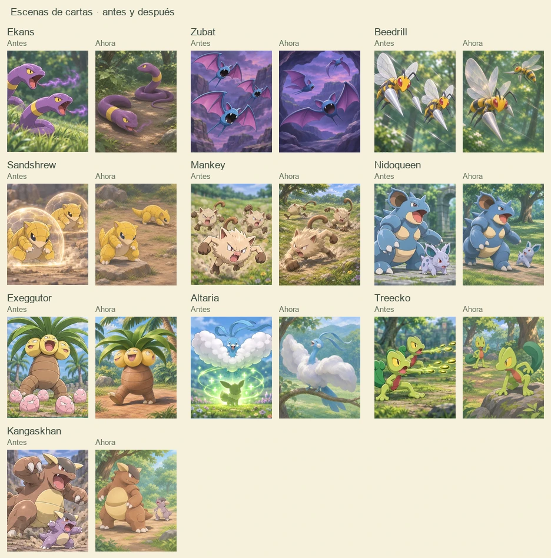

# Revisión de escenas de cartas

Se inspeccionaron las 105 ilustraciones del catálogo, con atención a poses repetidas, personajes superpuestos, fondos recargados y escenas que ya no representan la función de la carta. Se renovaron diez ilustraciones mediante ImageGen integrado.

| Carta | Cambio |
| --- | --- |
| Ekans | Dos poses y expresiones distintas sobre el mismo terreno. |
| Zubat | Tres ángulos de vuelo y posiciones de alas diferentes. |
| Beedrill | Dos gestos y orientaciones distintos dentro de una escena continua. |
| Sandshrew | Dos posturas propias, con sombras de contacto y sin escudos repetidos. |
| Mankey | Tres acciones diferentes con una perspectiva de grupo compartida. |
| Treecko | Dos acciones y ángulos distintos sobre un terreno continuo. |
| Nidoqueen | Madre y cría con escala, iluminación y suelo compartidos. |
| Kangaskhan | Un adulto y una cría claramente separados, con poses propias. |
| Exeggutor | Una figura sin las crías que lo confundían con Vivero. |
| Altaria | Paisaje continuo sin siluetas ni símbolos de curación superpuestos. |

Las escenas conservan el número de integrantes de cada grupo. Las nuevas composiciones se muestran en su orientación original, sin el reflejo que usaban algunas ilustraciones anteriores. Los archivos WebP miden 768 × 960 y mantienen su proporción en la colección, el detalle y la mano.

Se verificaron las tres vistas en 320 × 568, 390 × 844, 768 × 1024 y 1440 × 980. Las diez imágenes cargaron con sus dimensiones correctas y sin errores de JavaScript. Pasaron las 224 pruebas automatizadas y la comprobación de sintaxis. La inspección visual comprueba composición y legibilidad en esas vistas, sin sustituir pruebas con jugadores.

Los archivos están en [dist/assets/cards](../dist/assets/cards), con el sufijo `SceneV2.webp`. Los prompts completos y las decisiones por carta están en [CARD-ART-REVIEW.json](CARD-ART-REVIEW.json).

## Pendientes

ImageGen integrado rechazó las salidas de estas tres cartas en las variantes probadas, incluidas ediciones puntuales. Se conservaron sus ilustraciones actuales.

| Carta | Problema identificado |
| --- | --- |
| Nidoking | Las crías no corresponden a su función actual. |
| Chansey | El Pikachu cortado en el borde parece superpuesto. |
| Blissey | Las siluetas y los signos de curación parecen elementos de interfaz. |
