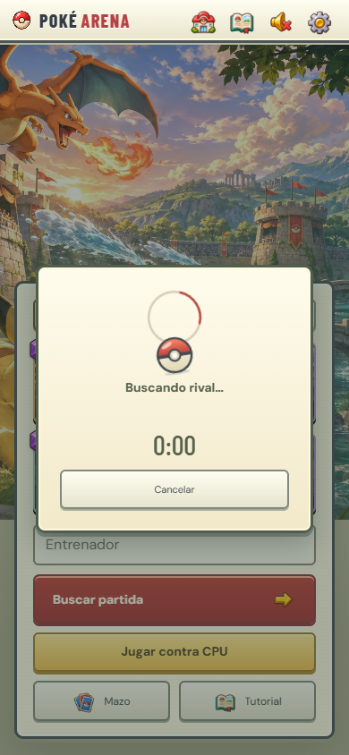

# Revisión de UI/UX · 12 de noviembre de 2026

Se revisaron la home, el editor, las fichas, una partida contra CPU, una partida online entre dos sesiones y Ajustes. Las capturas corresponden a esta revisión. El criterio fue priorizar el tablero y sus controles, mantener el estilo de menús crema de la época GBA/DS y usar texto que ayude a jugar.

1. **Home: corregida y verificada.** Los cuatro mazos siguen guardándose automáticamente. Se corrigió el contraste del coste medio y se compactó el panel de portátiles: Mazo y Tutorial quedan visibles en 1280 × 720. Los botones principales tienen al menos 44 px de alto.

   

2. **Editor y ficha: corregidos y verificados.** Los cuatro selectores están junto a la X, sin título ni contador general. Tocar una carta abre la ficha para agregar o quitar desde allí. El coste medio comparte el pie con Listo. Las fichas se cierran al agregar o quitar y el editor conserva su estado. La gema tiene el número centrado con una tipografía más ancha y un contorno fino. Los nombres se alinean arriba y los roles abajo. Las ilustraciones conservan su proporción en colección, mano y miniaturas, con recorte centrado cuando cambia el formato. Las estadísticas usan sprites ilustrados y el botón inferior sigue visible mientras el contenido se desplaza. Las 105 descripciones explican la acción principal en una frase breve, con los valores en las estadísticas.

   
   

   La búsqueda sin coincidencias ofrece una acción para recuperar todas las cartas. La ayuda presenta tres pasos breves y deja las reglas completas como contenido opcional. Pausa, victoria y derrota comparten el panel crema y los controles ilustrados.

   
   

3. **Partida contra CPU: corregida y verificada.** En móvil se oculta toda la cabecera para dar ese espacio a la arena. Nombre rival, reloj y pausa están sobre el tablero. En escritorio se eliminó el fondo distinto del panel derecho, los títulos y accesos al mazo y los créditos. Las habilidades usan retratos de las cartas y paneles crema con borde dorado. Mostrar una o tres habilidades, el tiempo extra o un aviso no mueve la arena, la mano ni el elixir. El contador tampoco desplaza la barra al pasar de 9 a 10.

   
   

4. **Partida online: verificada.** No hay pausa ni acceso al mazo durante la partida, tampoco mediante Espacio. Abrir ajustes desde escritorio o girar el teléfono no pausa la simulación online. Se comprobó además que una respuesta de despliegue demorada no deja el indicador ni permite duplicar la carta. Al finalizar se vuelve a la home para editar el mazo.

   

5. **Ajustes: corregidos y verificados.** Se reemplazó el fondo oscuro del selector y se hicieron visibles los interruptores. Los créditos se abren únicamente desde Ajustes. Durante una partida de escritorio, la dificultad informa que se aplica a la próxima CPU. La práctica guiada se inicia desde la home.

   

6. **Orientación y recuperación: verificadas con límites de plataforma.** El juego pide orientación vertical en dispositivos táctiles. Cuando el navegador no permite bloquearla, un aviso impide jugar en horizontal. Al girar se conserva una pausa manual; la pausa automática por orientación sólo se aplica contra CPU. El audio intenta reanudarse al volver a la página y reconstruye su contexto en la siguiente interacción si Safari lo deja bloqueado, conservando las grabaciones y la preferencia de silencio.

   

También se corrigieron señales de combate que daban información equivocada: Voltorb y los demás melee no muestran círculo de alcance; la Pandilla Rocket despliega tres Poochyena adelante y dos Ralts detrás, incluso al ajustar la colocación y al invertir la perspectiva online; Exeggutor libera cada pareja en fila con 0,85 s entre salidas. Las defensas no atraen win conditions al otro puente: el límite lateral es una celda pasada la mitad, o dos para cuerpos grandes como Golem.

La comprobación detrás del rey encontró una única fila central desplegable: en la grilla actual corresponde a y = 760 para el jugador inferior y a y = 40 para el superior. Se conservó esa fila; el margen visual incluye la base y la información de la torre.

Se probaron ocho tamaños de ventana, de 320 × 568 a 1680 × 1400, cinco tipos de ficha en cuatro tamaños, dos jugadores online y el modo vertical con un perfil táctil. Pasaron 224 pruebas automatizadas. Se comprobaron además las proporciones, los nombres y los números de las 105 cartas en móvil, tablet y escritorio. La recuperación de audio se comprobó con AudioContext real en Chromium y con estados interrumpidos, rechazos y relojes congelados simulados. El [reporte de WebKit](https://bugs.webkit.org/show_bug.cgi?id=276016) documenta la familia de fallos de Safari que motivó esa recuperación.

Queda pendiente confirmar el bloqueo nativo y la recuperación del sonido en un iPhone físico. Las capturas y las pruebas de interacción tampoco sustituyen una revisión con lector de pantalla o pruebas con jugadores.

Los iconos se generaron con ImageGen integrado. El recurso está en [stat-icons.webp](../dist/assets/ui/stat-icons.webp) y el prompt completo en [IMAGE-PROMPTS-UI.json](IMAGE-PROMPTS-UI.json).

La revisión visual del catálogo y sus prompts están en [CARD-ART-REVIEW.json](CARD-ART-REVIEW.json). Se priorizó una silueta clara, fondos tranquilos, textura limpia y contraste equilibrado. Impactrueno conserva su ilustración. El sandbox de balance y sus mediciones están en [BALANCE-SIMULATIONS.md](BALANCE-SIMULATIONS.md).

La carga inicial usa una Pokébola animada con progreso real de sprites y atlas. La búsqueda, los errores y la reconexión aparecen en capas absolutas. La carga de sprites durante la partida tiene un indicador pequeño sobre la arena. Se demoraron y bloquearon solicitudes reales del navegador en 390 × 844, 768 × 1024 y 1440 × 980: los rectángulos del menú, los controles y el tablero permanecieron iguales antes, durante y después de cada espera. La prueba con movimiento reducido mantuvo estáticas las animaciones.

