# Revisión de UI/UX · 12 de noviembre de 2026

## Recursos y selección del mazo · 13 de noviembre

La colección marca las cartas del mazo activo con un borde verde y una marca de selección, sin ocupar espacio en el flujo. Las pruebas verifican que el indicador se actualice al agregar, reemplazar y quitar cartas. Las torres y bases usan ilustraciones raster. Los ataques, campos y partículas usan sprites originales con sus puntos de emisión por dirección. El agua de Remolino cubre su área real. Mazazo conserva la marca `PLACEHOLDER` mientras falta una animación de rodado adecuada.

Se comprobaron el editor, la partida y la carga demorada en 320 × 568, 390 × 844, 768 × 1024, 1440 × 980 y 932 × 430. Los estados transitorios conservaron los rectángulos de controles y contenido. La revisión online utilizó dos sesiones, reenvíos y reconexión. Los archivos de origen y los recursos pendientes se documentan en [BATTLE-ART-REVIEW.json](BATTLE-ART-REVIEW.json).

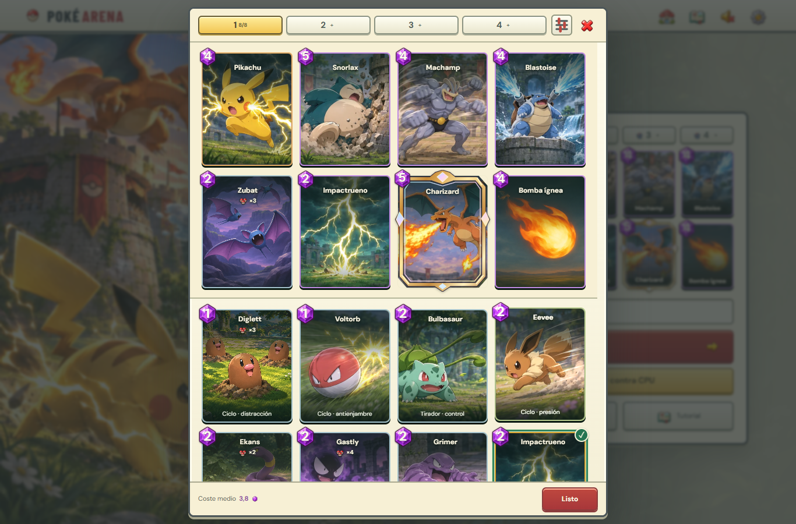
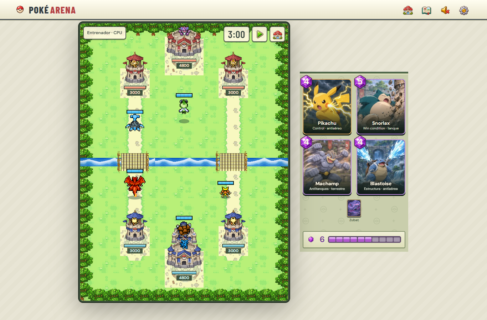

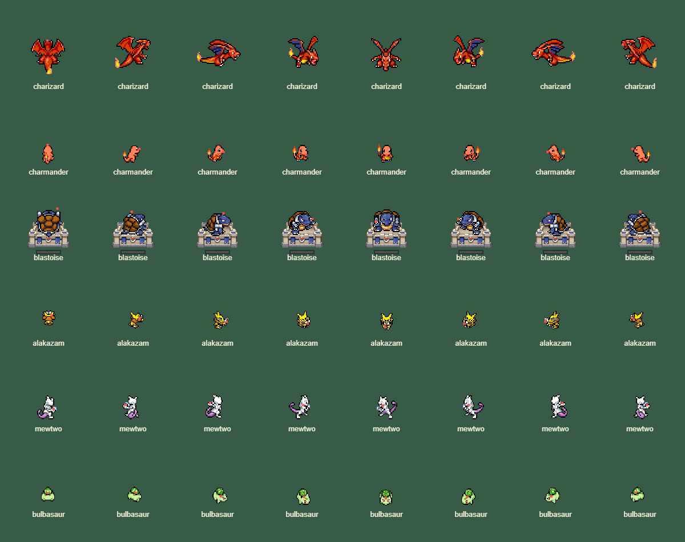

## Revisión anterior

Se revisaron la home, el editor, las fichas, una partida contra CPU, una partida online entre dos sesiones y Ajustes. Las capturas corresponden a esta revisión. El criterio fue priorizar el tablero y sus controles, mantener el estilo de menús crema de la época GBA/DS y usar texto que ayude a jugar.

1. **Home: corregida y verificada.** Los cuatro mazos siguen guardándose automáticamente. Se quitaron el título, el coste medio y la etiqueta visible del nombre; el campo conserva su etiqueta accesible. Se acomodaron las filas para aprovechar ese espacio, también en horizontal. El botón de CPU usa una tipografía consistente con los demás controles. Los botones principales tienen al menos 44 px de alto.

   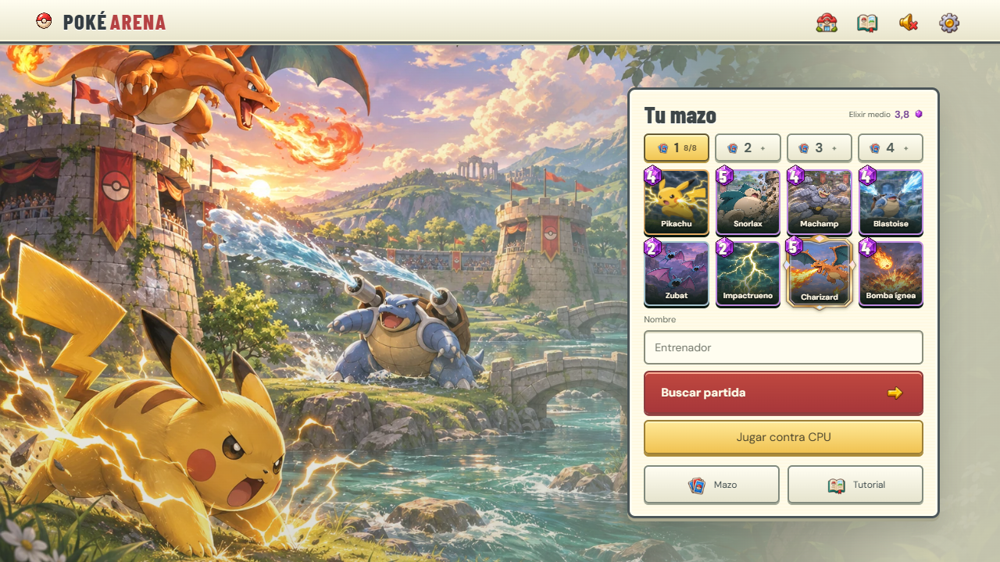

2. **Editor y ficha: corregidos y verificados.** Los cuatro selectores están junto a la X, sin título ni contador general. Tocar una carta abre un menú pequeño con Info y Usar o Quitar; Info abre la ficha detallada. El coste medio comparte el pie con Listo. El editor conserva su estado al cerrar la ficha. La gema tiene el número centrado con una tipografía más ancha y un contorno fino. Los nombres se alinean arriba y los roles abajo. Las ilustraciones conservan su proporción en colección, mano y miniaturas, con recorte centrado cuando cambia el formato. Las estadísticas usan sprites ilustrados y el botón inferior sigue visible mientras el contenido se desplaza. Las 105 descripciones explican la acción principal en una frase breve, con los valores en las estadísticas.

   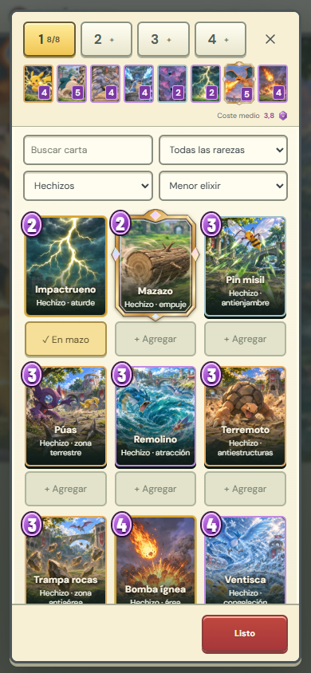
   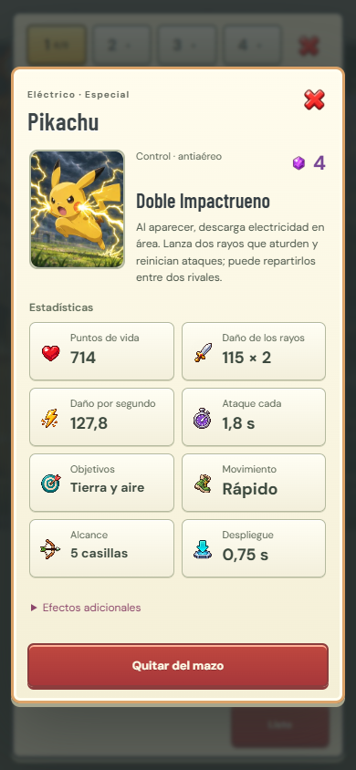

   La búsqueda sin coincidencias ofrece una acción para recuperar todas las cartas. La ayuda presenta tres pasos breves y un acceso a la práctica; se retiró el bloque extenso de reglas. Pausa, victoria y derrota comparten el panel crema y los controles ilustrados.

   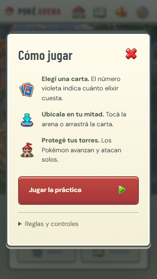
   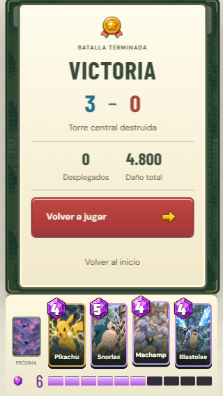

3. **Partida contra CPU: corregida y verificada.** En móvil se oculta toda la cabecera para dar ese espacio a la arena. Nombre rival, reloj y pausa están sobre el tablero. En escritorio se eliminó el fondo distinto del panel derecho, los títulos y accesos al mazo y los créditos. Las habilidades usan retratos de las cartas y paneles crema con borde dorado. Mostrar una o tres habilidades, el tiempo extra o un aviso no mueve la arena, la mano ni el elixir. El contador tampoco desplaza la barra al pasar de 9 a 10.

   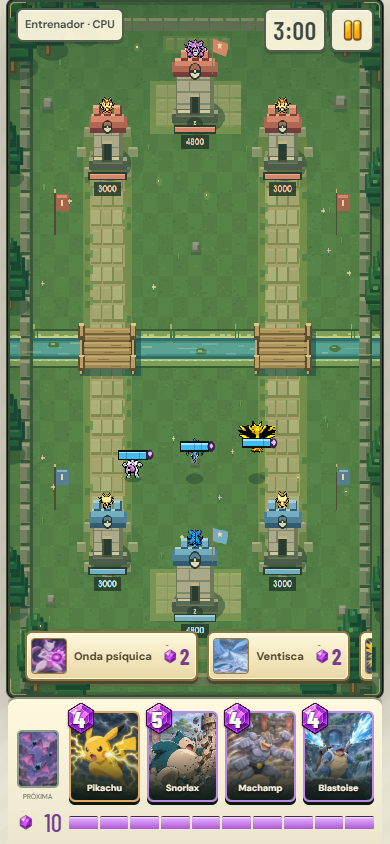
   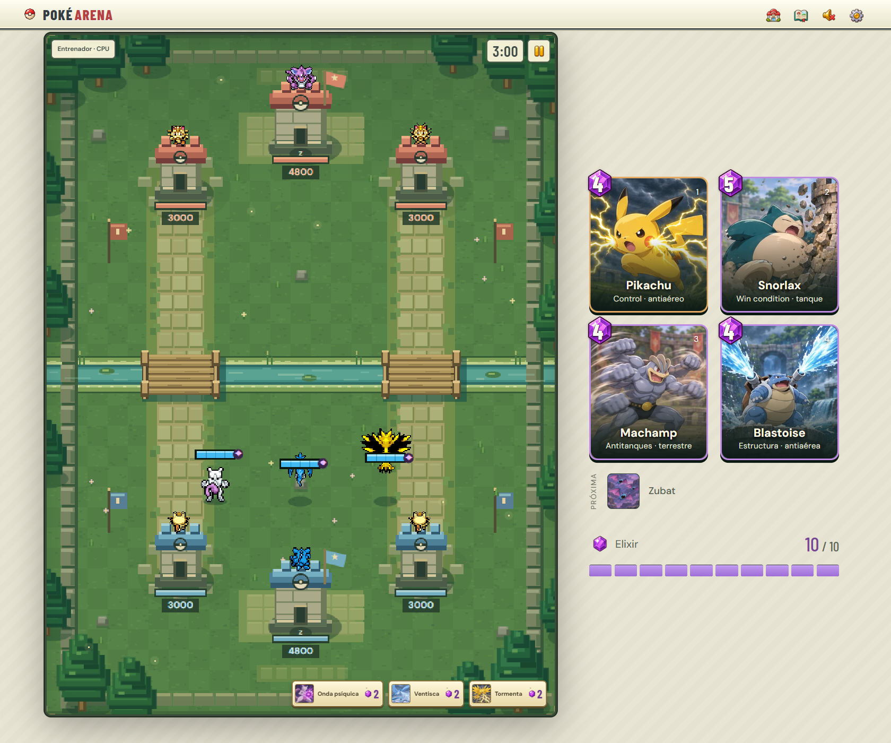

4. **Partida online: verificada.** No hay pausa ni acceso al mazo durante la partida, tampoco mediante Espacio. Los accesos al inicio están bloqueados mientras la partida sigue activa. Una recarga recupera la misma sesión y sala, sin enviar una cancelación ni iniciar otra búsqueda. La recuperación comienza antes de terminar de descargar las imágenes. Si la recarga ocurre durante una búsqueda, continúa esa búsqueda. Abrir ajustes desde escritorio o girar el teléfono no pausa la simulación online. Se comprobó además que una respuesta de despliegue demorada no deja el indicador ni permite duplicar la carta. Al finalizar se vuelve a la home para editar el mazo.

   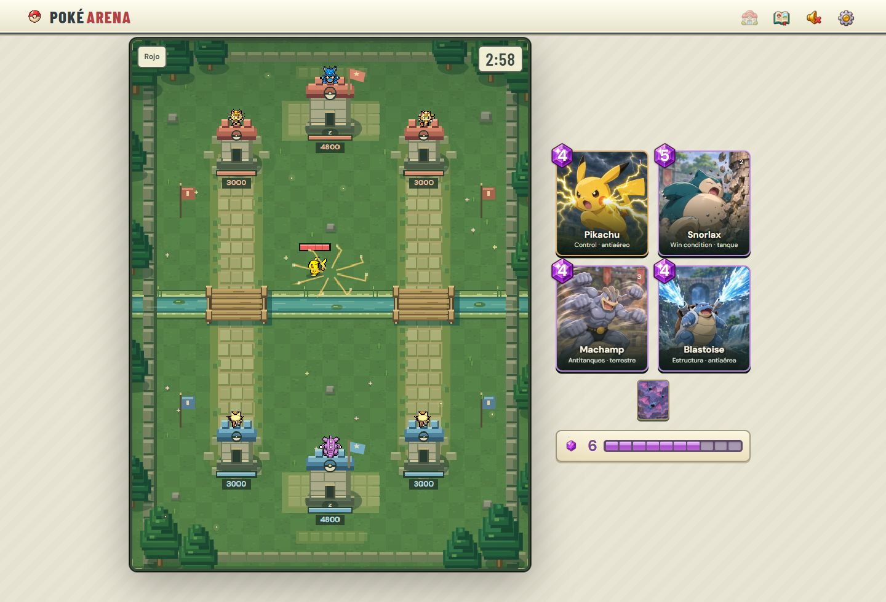

5. **Ajustes: corregidos y verificados.** Se reemplazó el fondo oscuro del selector y se hicieron visibles los interruptores. Los créditos se abren únicamente desde Ajustes. Durante una partida de escritorio, la dificultad informa que se aplica a la próxima CPU. La práctica guiada se inicia desde la home.

   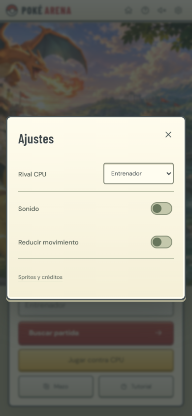

6. **Orientación y recuperación: verificadas con límites de plataforma.** El juego pide orientación vertical en dispositivos táctiles. Cuando el navegador no permite bloquearla, un aviso impide jugar en horizontal. Al girar se conserva una pausa manual; la pausa automática por orientación sólo se aplica contra CPU. El audio intenta reanudarse al volver a la página y reconstruye su contexto en la siguiente interacción si Safari lo deja bloqueado, conservando las grabaciones y la preferencia de silencio.

   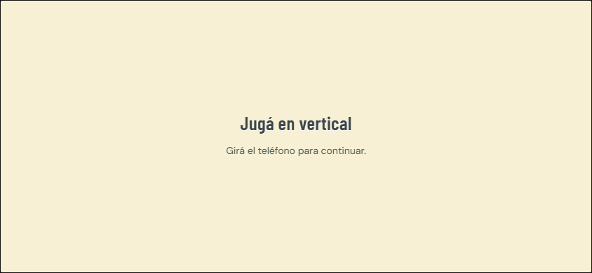

También se corrigieron señales de combate que daban información equivocada: Voltorb y los demás melee no muestran círculo de alcance; la Pandilla Rocket despliega tres Poochyena adelante y dos Ralts detrás, incluso al ajustar la colocación y al invertir la perspectiva online; Exeggutor libera cada pareja en fila con 0,85 s entre salidas. Las defensas no atraen win conditions al otro puente: el límite lateral es una celda pasada la mitad, o dos para cuerpos grandes como Golem.

Las torres del rey se movieron una celda hacia el borde de cada equipo: `KING_Y = [706, 94]`. Queda una sola fila completa detrás de sus bases, con colocación válida en y = 760 para el jugador inferior y en y = 40 para el superior. Los snapshots antiguos se migran al restaurar y conservan esa disposición al invertir la perspectiva online.

Se probaron ocho tamaños de ventana, de 320 × 568 a 1680 × 1400, cinco tipos de ficha en cuatro tamaños, dos jugadores online y el modo vertical con un perfil táctil. Pasaron 224 pruebas automatizadas. Se comprobaron además las proporciones, los nombres y los números de las 105 cartas en móvil, tablet y escritorio. La recuperación de audio se comprobó con AudioContext real en Chromium y con estados interrumpidos, rechazos y relojes congelados simulados. El [reporte de WebKit](https://bugs.webkit.org/show_bug.cgi?id=276016) documenta la familia de fallos de Safari que motivó esa recuperación.

Queda pendiente confirmar el bloqueo nativo y la recuperación del sonido en un iPhone físico. Las capturas y las pruebas de interacción tampoco sustituyen una revisión con lector de pantalla o pruebas con jugadores.

Los iconos se generaron con ImageGen integrado. El recurso está en [stat-icons.webp](../dist/assets/ui/stat-icons.webp) y el prompt completo en [IMAGE-PROMPTS-UI.json](IMAGE-PROMPTS-UI.json).

La revisión visual del catálogo y sus prompts están en [CARD-ART-REVIEW.json](CARD-ART-REVIEW.json). Se priorizó una silueta clara, fondos tranquilos, textura limpia y contraste equilibrado. Impactrueno conserva su ilustración. El sandbox de balance y sus mediciones están en [BALANCE-SIMULATIONS.md](BALANCE-SIMULATIONS.md).

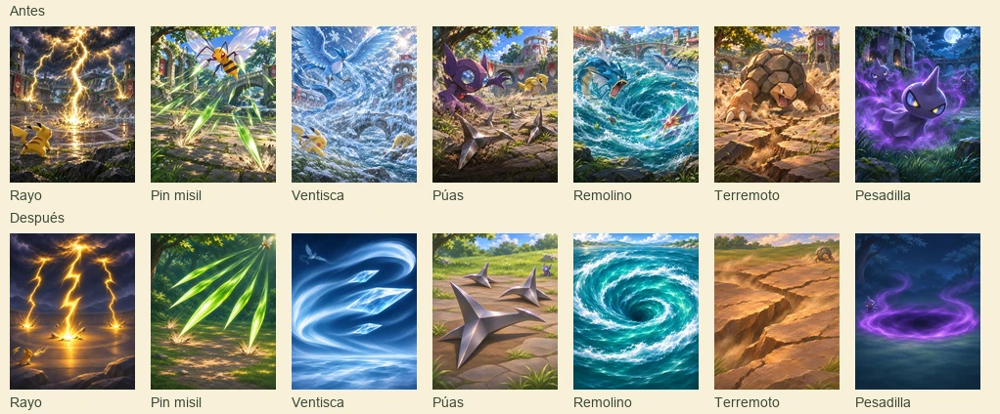

La carga inicial usa una Pokébola animada con progreso real de sprites y atlas. La búsqueda, los errores y la reconexión aparecen en capas absolutas. La carga de sprites durante la partida tiene un indicador pequeño sobre la arena. Se demoraron y bloquearon solicitudes reales del navegador en 390 × 844, 768 × 1024 y 1440 × 980: los rectángulos del menú, los controles y el tablero permanecieron iguales antes, durante y después de cada espera. La prueba con movimiento reducido mantuvo estáticas las animaciones.

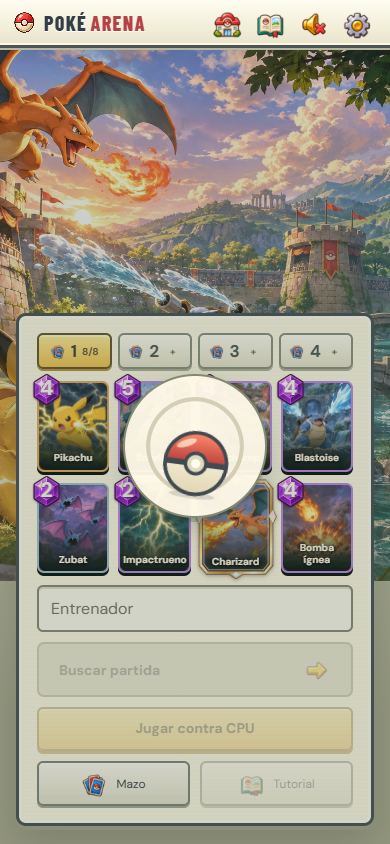

La última comprobación cubrió 320 × 568, 390 × 844, 768 × 1024, 1440 × 980 y 932 × 430. Las pruebas de carga demorada registraron cero cambios de posición o tamaño en el menú, la mano, la arena y el elixir. Tampoco se registraron eventos de desplazamiento visual durante esas pruebas locales. Se verificaron además la carga lenta de fuentes, los errores y su reintento, el movimiento reducido y una interrupción breve de conexión entre dos sesiones. Pasaron las 224 pruebas automatizadas, la comprobación de sintaxis, la compilación y la prueba del Worker generado.

La próxima carta conserva su proporción, queda centrada verticalmente y muestra su nombre pequeño debajo. El elixir usa un marco crema y segmentos morados. La guía mantiene tres pasos que se pueden omitir, con el mismo estilo de panel y botones del juego. Volver al inicio contra CPU pide confirmación; cancelar reanuda la partida o conserva una pausa manual previa.

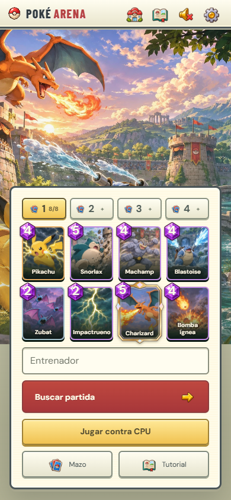
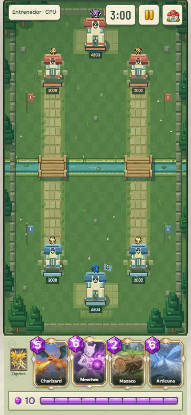
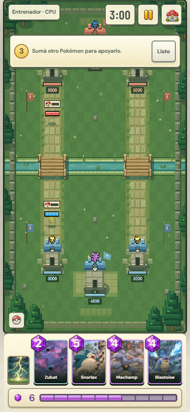
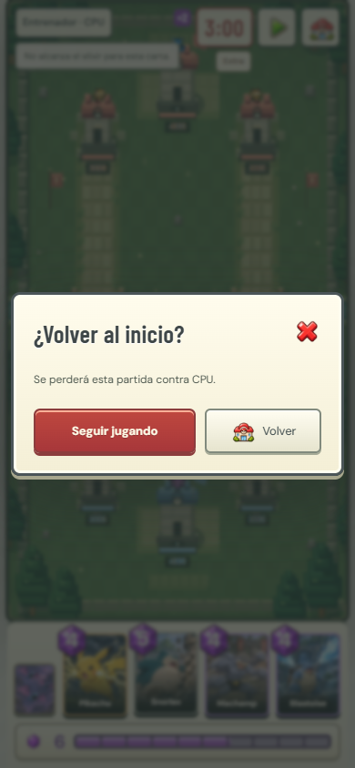

La reconexión conserva el margen existente del servidor: 25 segundos de ausencia antes de resolver la partida por desconexión. Las pruebas utilizaron Chromium en Windows; no verifican el comportamiento de un teléfono físico ni sustituyen una revisión con lector de pantalla.

Los nombres y roles de las 16 legendarias quedan dentro de la abertura del marco, en la colección, el mazo, la home y la mano. Se compararon los rectángulos del texto con los píxeles del ornamento en 320 × 568, 390 × 844, 768 × 1024 y 1440 × 980. La comprobación detectó y corrigió cruces en la colección, nombres largos de la home y roles de la mano de escritorio.

Abrir el editor o seleccionar otro mazo lleva la vista a las cartas elegidas y enfoca su selector. Las pruebas de navegador comprueban la reapertura después de desplazarse por la colección, el cambio entre mazos y la conservación de las cartas y su orden.

La siguiente revisión amplió el mazo a dos filas de cuatro cartas y redujo la altura de los selectores. El mazo y la colección comparten el desplazamiento: al bajar, sólo quedan las cartas de colección. Los filtros se abren desde un botón pequeño y Rareza queda al final, plegada. Con ocho cartas, Usar permite elegir cuál reemplazar. Los nombres subieron y las cantidades de enjambre se muestran debajo, sin fondo crema.

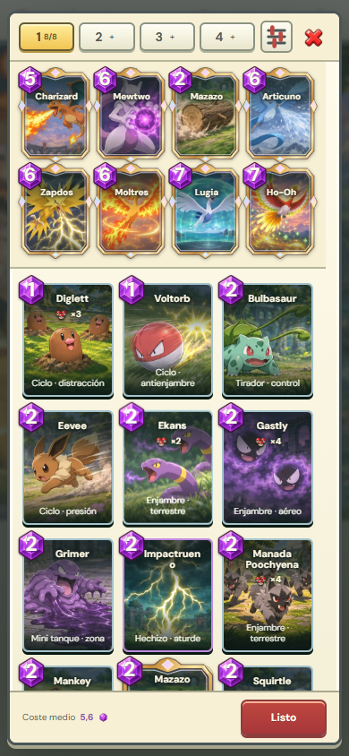
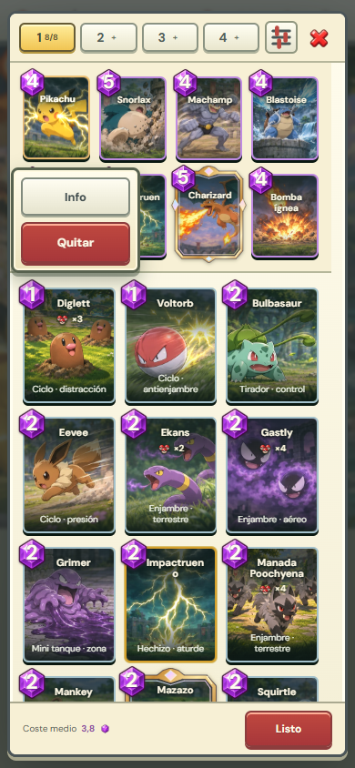
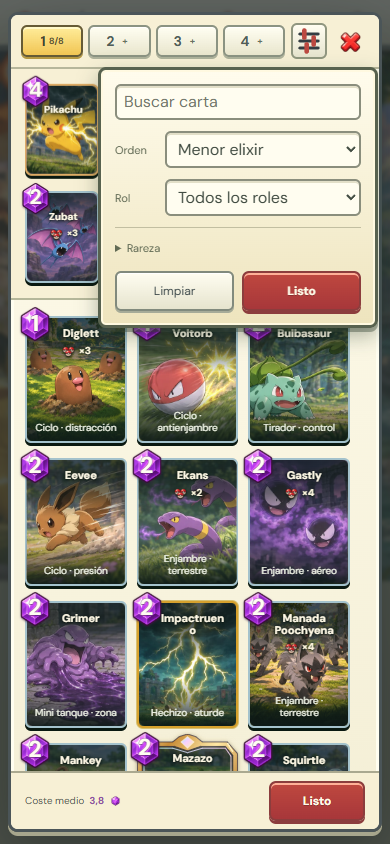
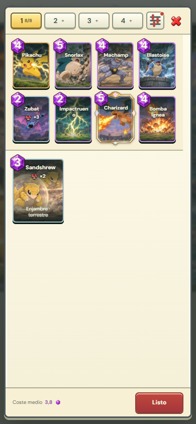

La Pokébola de carga se llena con el progreso real, centrada y sin aros exteriores; en esperas indeterminadas gira sobre su centro. El panel de combate tiene bordes rectos y un patrón tenue de Pokébolas. Las cartas sin elixir usan blanco y negro completo. El alcance tiene un relleno suave y una guía de colocación discreta. Las torres se dibujan como puestos de gimnasio y un Centro Pokémon, conservando sus huellas de combate.

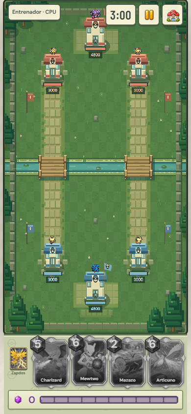
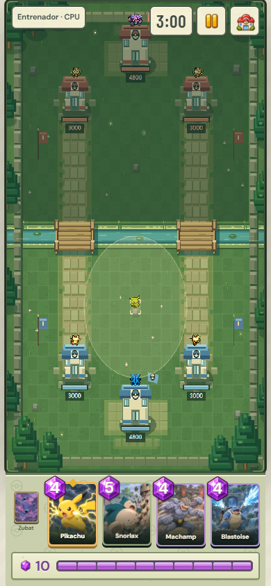

Estas modificaciones pasaron las 226 pruebas de lógica existentes y la revisión visual en cinco tamaños. Después se separaron las pruebas por sección según la tabla del README. La comprobación aislada del editor recorrió filtros, acciones, reemplazo y guardado en 2,6 segundos, en un tamaño móvil y con cero solicitudes a la API. También pasaron las 11 pruebas de guardado y las cuatro de selección de suites. Esta separación no volvió a ejecutar combate, conexión, audio ni balance. La suite completa queda para cambios transversales explícitos.
