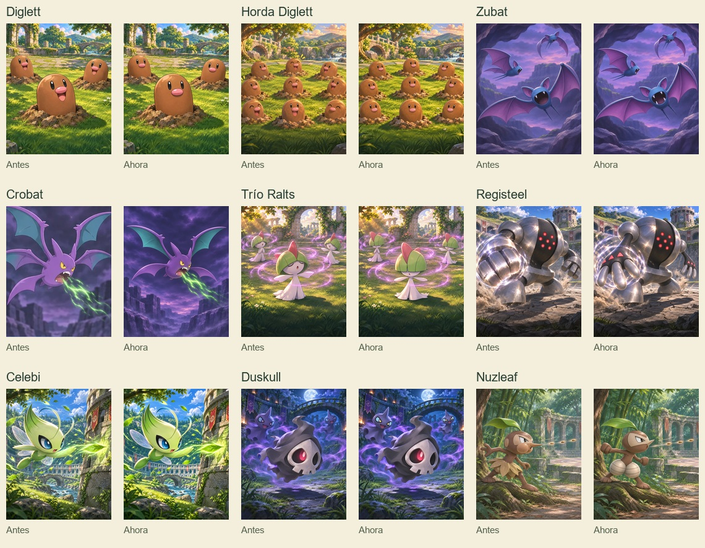
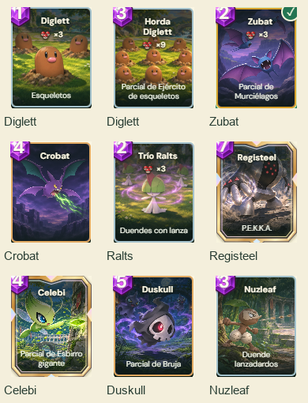

# Revisión de fidelidad de Pokémon

14 de noviembre de 2026. Se compararon individualmente los **111 artworks enlazados en `CARD_ART`**: 109 cartas disponibles y las ilustraciones de Electrode y Exeggutor conservadas para compatibilidad. También se revisaron los Pokémon secundarios de enjambres, estructuras y hechizos y la portada del menú. La referencia fue el artwork oficial de cada especie, conservado en `dist/assets/pokemon/<id>/art.png`, junto con la [Pokédex oficial](https://www.pokemon.com/pokedex/).

Se corrigieron nueve escenas mediante **ImageGen integrado**, conservando fondos, iluminación, acciones y cantidad de personajes. Los archivos nuevos tienen nombres distintos para que la caché de las imágenes anteriores no oculte la actualización.

| Carta | Corrección | Archivo activo |
| --- | --- | --- |
| Diglett | Los tres tienen ojos neutros y nariz rosa, sin bocas ni sonrisas. | `diglettV2.webp` |
| Horda Diglett | Los nueve quedan sin bocas, ojos sonrientes ni marcas de entusiasmo. | `diglettHordeV2.webp` |
| Zubat | Los tres quedan sin ojos ni cejas y con colmillos superiores e inferiores. | `zubatSceneV3.webp` |
| Crobat | Se eliminan las alas adicionales; quedan exactamente cuatro. | `crobatSceneV2.webp` |
| Trío Ralts | Flequillo cubriendo los ojos, aletas de cabeza y brazos simples. | `raltsTrioV2.webp` |
| Registeel | Antebrazos oscuros y manos de tres dedos claros con marcas rojas. | `registeelV2.webp` |
| Celebi | Se elimina el ala adicional; queda un par de alas. | `celebiV2.webp` |
| Duskull | Se corrigen los ojos de los dos Shuppet del fondo a cian, violeta y amarillo. | `duskullV2.webp` |
| Nuzleaf | Muslos claros segmentados, máscara, nariz y manos; se quitan la falda de hojas y las mejillas infladas. | `nuzleafV2.webp` |

En las demás escenas no se detectaron otras diferencias anatómicas que justificaran reemplazarlas. Se distinguieron las poses, la perspectiva y los rastros de movimiento de los apéndices añadidos. El [registro completo](review.json) contiene una observación específica para cada una de las 111 cartas, las especies secundarias, la decisión y el archivo activo. Los sprites nativos de combate se conservan.





Las siete láminas de comparación con las referencias oficiales son [1](comparison-01.jpg), [2](comparison-02.jpg), [3](comparison-03.jpg), [4](comparison-04.jpg), [5](comparison-05.jpg), [6](comparison-06.jpg) y [7](comparison-07.jpg). Los [prompts completos y las salidas seleccionadas](prompts.json) documentan las nueve ediciones. Las imágenes del juego están en `dist/assets/cards/`.

Pasaron las 13 pruebas de mazo, las 39 de rendering y la comprobación de sintaxis. La compilación local del Worker terminó correctamente: siete módulos de recursos de menos de 6,3 MB cada uno, por debajo del límite de 32 MiB del repositorio de Sites.

La revisión de navegador abrió las nueve cartas en 390 × 844, 768 × 1024 y 1440 × 980, comprobó los bytes servidos y la decodificación de las imágenes, y capturó sus vistas de detalle. Se demoraron las nueve imágenes mientras se comparaban los rectángulos de la colección y sus controles antes, durante y después de la espera: **desplazamiento máximo 0 px** en los tres tamaños. Se cargaron los 50 archivos gráficos distintos del catálogo sin errores de JavaScript ni solicitudes a las API de partidas. También pasó la prueba de navegador del editor de mazo. Las [mediciones](ui/validation.json) y [capturas](ui/) quedan junto al registro. La inspección comprueba fidelidad y representación en esas vistas; no evalúa disfrute ni facilidad de uso con jugadores.

Para repetir la revisión local, con Playwright disponible en `qa/node_modules/playwright` o mediante `POKE_ARENA_PLAYWRIGHT_MODULE`:

```powershell
node scripts/review-artwork-fidelity.mjs
python scripts/artwork-fidelity-contact.py
python scripts/artwork-fidelity-proof.py
```

Los cambios y el Worker se verificaron localmente. El usuario autorizó explícitamente su publicación en Poké Arena el 14 de noviembre de 2026.
